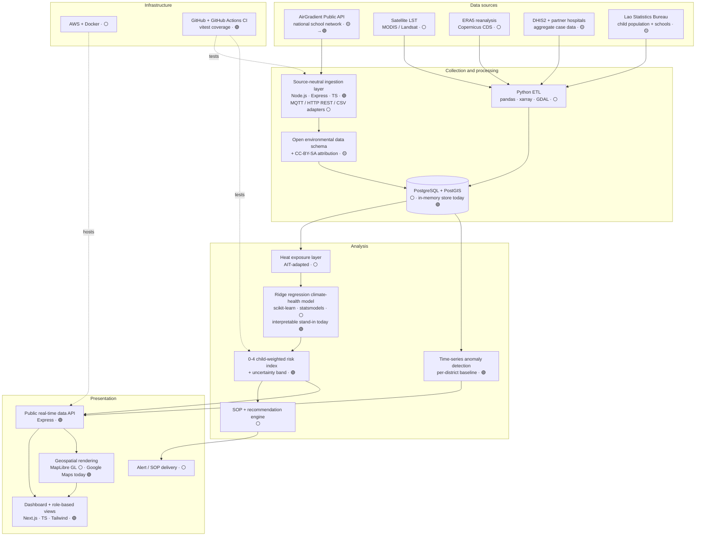
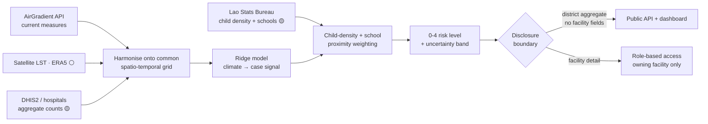

# CHIP — Architecture

This document backs **Template 2, Annex 1 (tech stack)** and **Annex 2 (data
flow)**. Diagrams render on GitHub. Status legend:

- 🟢 **implemented** — running in this repository today
- 🟡 **synthetic** — running on synthetic/fallback data; real source integrated under the workplan
- ⚪ **planned** — scheduled milestone (Q1–Q4 2027)

All software components are **MIT**; data products derived from AirGradient
measurements are **CC-BY-SA 4.0** (see `NOTICE`).

## Annex 1 — Tech stack

## Annex 2 — Data flow and the two-tier disclosure boundary

Public outputs aggregate to **district** level with every facility-identifying
field excluded; facility detail returns only under role-based access. Automated
tests assert that no facility-identifying field can reach the public layer.

## What runs in this repository today (Phase 1)

- `chip-backend`: Express + TS API serving the **0-4 child-weighted risk index**
  over a **source-neutral ingestion layer** (real AirGradient connector with a
  synthetic fallback). Vitest coverage ≥ 80%.
- `chip-frontend`: Next.js dashboard presenting the index, risk map, exposure
  trend, district deviations, monitoring network and per-source status.
- The risk model is an interpretable stand-in for the Ridge regression model
  (Q2 2027). See `docs/model-card.md`.
